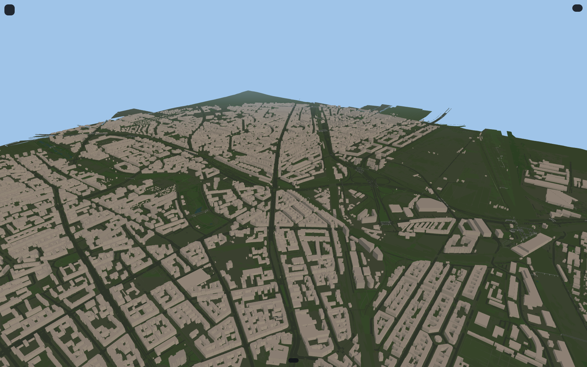
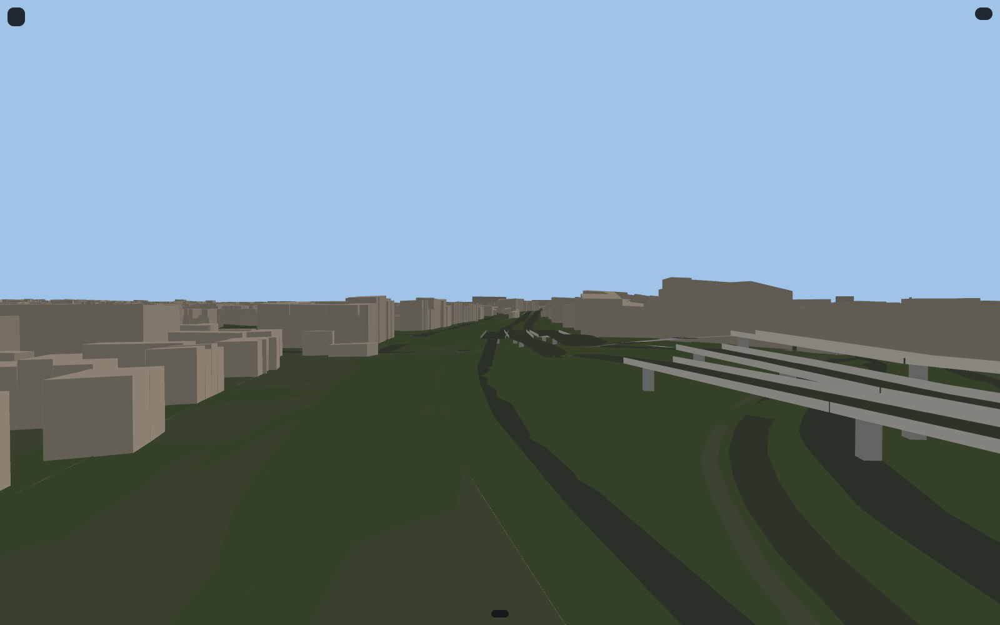
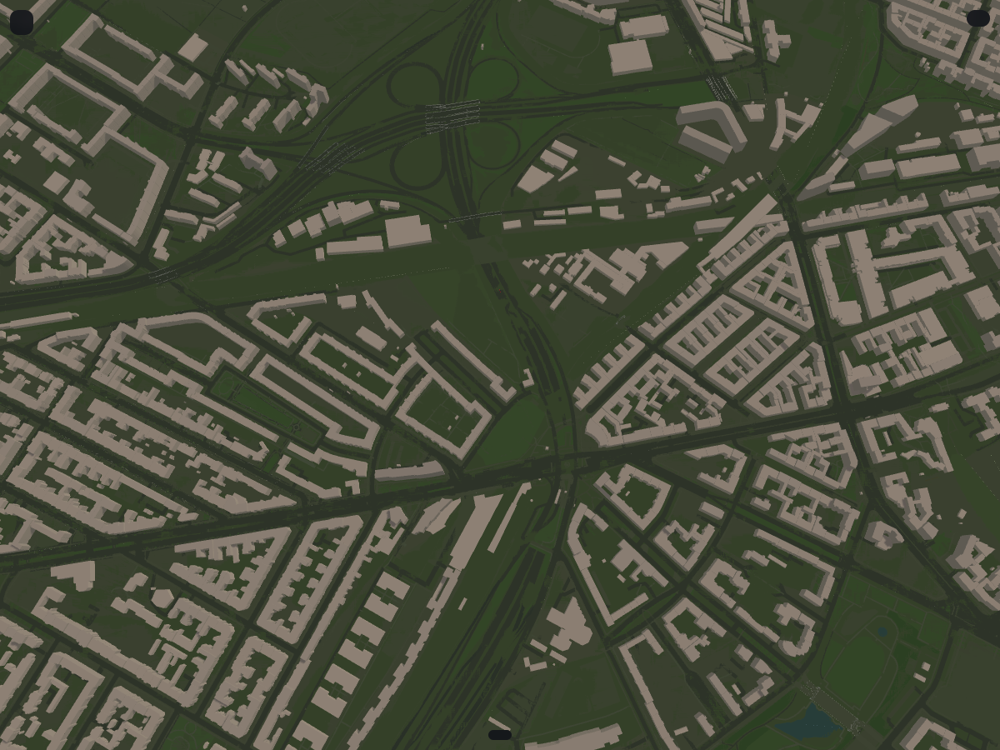

# vibe heightfield — 3D OpenStreetMap POC (S Friedenau, Berlin)

A **3D OpenStreetMap visualization** as a static web app (GitHub Pages), branch `heightfield`.
It renders a **2 km radius around S-Bahnhof Friedenau in Berlin** in 3D: buildings with real
heights, multi-level roads (bridges, tunnels, ramps), real terrain elevation — and a small car
you can drive on the road network, including **under bridges**.

Live demo (deployed from this branch): https://svenpilz.github.io/vibe/vibe-heightfield/

The 2D micromapping visualizer lives on `main` (https://svenpilz.github.io/vibe/).

## Controls

| Input | Action |
|---|---|
| left-drag | pan in the ground plane (never changes height; leaves chase cam) |
| wheel / middle-drag | zoom towards the mouse cursor |
| right-drag | orbit around the screen center (the current target) |
| `W A S D` or arrow keys | drive the car (accelerate / steer / brake-reverse) |
| `C` | toggle chase cam (camera follows the car) |
| `V` | first-person driver view (camera aligned with the car's driving direction) |
| `H` | cycle terrain source (DGM1-cleaned DOM1 / raw DGM1 / raw DOM1) |
| `T` | terrain-only mode: show just the terrain surface (e.g. only the cleaned DOM values), OSM overlays hidden |
| `R` | reset the car to its spawn point |

A north-up minimap (bottom-right) shows a 500 m radius around the car with roads, buildings,
the car marker and the camera view direction.

The camera view (location, zoom, orientation) is continuously written to the URL hash
(`#c=x,y,z&t=x,y,z`) and restored on reload, so a shared/refreshed link keeps the view.
In terrain-only mode (`T`) the terrain is color-coded by elevation (hypsometric ramp).

The car drives on the road network (elevation-aware snapping, so it can pass **under bridges**,
and on a `layer=1` deck it drives 5 m above the road below) and can also go **off-road** — it then
follows the bare-earth DGM1 terrain with extra drag. Buildings block the car.

## Real heights — three combined sources

| What | Source | How |
|---|---|---|
| Terrain (absolute elevation) | **Berlin ATKIS DGM1 + DOM1** — official 1 m LiDAR models (DHHN2016, UTM33N xyz tiles via `gdi.berlin.de/data/dgm1/atom` and `/data/dom/atom`, DL-DE-Zero) | baked into 880×880 grids (5 m cells, bilinearly sampled from the original 1 m lattice). Default view is the **cleaned DOM1** (trees removed, see below); `H` cycles raw DGM1 / raw DOM1. SRTM only as last-resort pipeline fallback |
| Building heights | OSM `height=*` / `building:levels` first (validated against `building:part` ways), else **median DOM−DGM over the footprint**, else 10 m default | `buildingHeightTaggedM` / `buildingHeightFromDom` in `src3d/mesh.ts` |
| Road vertical stacking | OSM `layer=*` (+ `bridge=yes`/`tunnel=yes` implying ±1), per-node `ele=*` pins | deck = terrain + layer × 5 m; connecting roads ramp within 60 m; non-link motorways never ramp (they pass under bridges in cuttings); ribbons are subdivided at terrain grid lines so they always render above the surface |

Data is extracted from the **Geofabrik Berlin `.osm.pbf`** (100 MB, parsed with the repo's own
PBF parser `src/osm-pbf.ts`) and baked into `public/data/friedenau-2km.json` (~9 MB, plus a
precompressed `.json.gz` that GitHub Pages serves with `Content-Encoding: gzip`).

## Rebuilding the data

```bash
npm install
npm run build:data   # downloads + parses the Berlin PBF, fetches SRTM tiles, writes public/data/
```

Raw downloads are cached in `.vibe/cache/` (gitignored).

## Develop / build / test

```bash
npm run dev      # vite dev server, open the printed URL
npm run build    # tsc + vite build -> dist/ (static, Pages-ready)
npm test         # all regression tests incl. the heightfield suites
```

## Architecture

- `scripts/build-friedenau-data.ts` — data pipeline (PBF extract + DEM sampling + compact JSON).
- `scripts/png.ts` — dependency-free PNG decoder for the terrarium tiles.
- `src3d/geo.ts` — local equirectangular projection around S Friedenau (pure, shared).
- `src3d/schema.ts` — baked-data schema + all derived values (heights, layers, widths, colors).
- `src3d/mesh.ts` — pure geometry builders (terrain heightfield, road ribbons + parapets,
  extruded buildings, ground polygons, road spatial index). No three.js import → unit-testable.
- `src3d/main.ts` — three.js scene, OrbitControls, car physics + road constraint, HUD.
- `tests/heightfield-*.ts` — unit tests for the above plus dataset integrity checks.

## Screenshots (headless-rendered verification)

| Overview — roads as gray strips on the terrain, extruded buildings | Under a bridge — elevated deck with piers over the lower road | Top-down city center |
|---|---|---|
|  |  |  |

Known POC limitations: building multipolygon relations (courtyards) are not assembled, roofs are
flat, tunnels are occluded by the terrain surface when viewed from above.

## Build summary & lessons learned

**Coordinate frames.** Local frame is equirectangular around S Friedenau (x = east, y = north).
The DEM tiles are UTM33N — the two frames differ by the UTM scale factor (~0.2 %, up to ~4 m at
2 km), so every grid vertex is converted local → lon/lat → true UTM33N before sampling, keeping
OSM and DEM aligned. three.js is right-handed, so rendering uses z = −north (`toGeometry` flips z);
otherwise the map renders mirrored (Wielandstraße and every E-W feature flipped).

**Height data.** DGM1 = bare earth, DOM1 = surface (roofs, trees, cars), both 1 m LiDAR, baked at
5 m with bilinear sampling of the original lattice (no pooling — pooling smooths cuttings/roofs).
`H` cycles cleaned DOM1 / raw DGM1 / raw DOM1; `T` shows terrain only, color-coded by elevation on a
fixed 30–80 m hypsometric ramp. The view (camera + target) lives in the URL hash (`#c=…&t=…`).

**Tree filter (trained on OSM trees).** Viewing the height field as a manifold: trees/signs/cars
are *blobs* — high curvature in both directions; real edges curve in one direction only. The
cleaned DOM keeps the DOM surface itself and removes only trees: mapped `natural=tree` points are
hard-masked to DGM (these are the training labels), and unmapped tall blobs
(`min(|dxx|,|dyy|) > 0.3 m` — threshold learned from the mapped trees, 88.6 % recall — **and**
> 1.5 m above DGM) are smoothed with a 5×5 median kernel (edge-preserving) with a DGM fallback.
Building footprints (dilated 0.75 cell) and bridge corridors (layer>0 ways, 8 m) also mask to DGM —
the 3D prisms/decks replace them, so no green tents over buildings and bridges span without piers.

**Roads.** Elevations = per-node `ele=*` (surveyed, used only when within 1.5 m of the terrain model,
so a stray ele can't split two carriageways) else terrain sample, + layer × 5 m + lift. Ribbons are
subdivided at terrain grid lines/diagonals and clamped ≥ terrain + 0.05 m, so roads are never
buried (verified: 263 k segments, 13.4 M samples, 0 below terrain). Grade smoothing capped at 8 %.
Bridge ways keep their own layer at junctions (no deck cliffs). Non-link motorways/trunk don't ramp
to bridge decks — under the Friedenauer Brücke they sit at cutting level, slightly above the
S-Bahn tracks.

**Buildings.** `building:part` ways are baked and rendered with their own heights; an outline
containing parts is demoted to a podium at the lowest part. Height precedence: curated OSM tags
(beat the DOM median, which underestimates small roofs — benchmark OSM way 396510792) → DOM median
→ default. Facade texture shows one window row per `building:levels`.

**Verification.** `npm test` runs 24 suites: unit tests for the pure geometry/schema modules plus
dataset integrity checks (grid size, height ranges, ele tags, tree-mask recall, bridge deck
continuity). All geometric claims above are asserted there or were measured on the real extract
(see commit messages).

