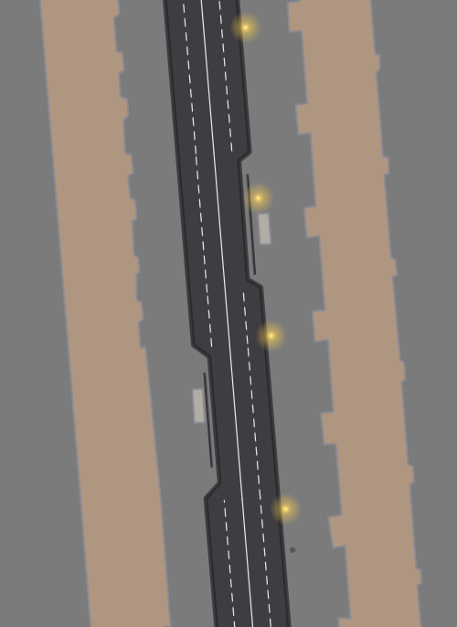
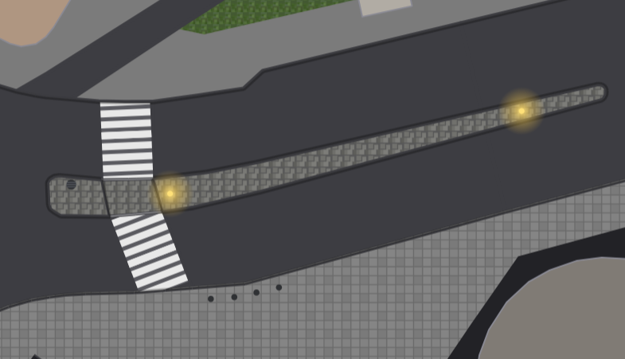
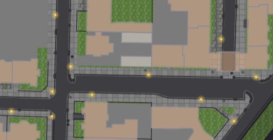

# OSM Micromapping Visualizer

A TypeScript app that renders **any OpenStreetMap `.osm.pbf` extract** in the browser with a
focus on street-level micromapping: `area:highway` surfaces, footways and crossings with
real-world markings, kerbs, building outlines, grass areas and inferred lane markings.

**No data is bundled or built** — drag & drop a PBF at runtime and it renders. Works with any
Geofabrik extract (Berlin, Bavaria, Netherlands, …) or your own `.osm.pbf`.

Live demo: https://svenpilz.github.io/vibe/

## Examples

| Lane markings with different road widths | Footway crossing | Residential area with sidewalks |
|---|---|---|
|  |  |  |

## Usage

```bash
npm install
npm run dev      # open the printed URL
```

Then drag a `*-latest.osm.pbf` from [download.geofabrik.de](https://download.geofabrik.de/index.html)
onto the page. The file is parsed entirely in your browser — it is not uploaded anywhere.
Scroll to zoom, drag to pan, click any feature to inspect its tags (including a link to the
object on openstreetmap.org). The status bar shows the current zoom level and the deployed
git commit.

## Specification

### 1. Coordinate and scale handling

- Positions are stored as integers quantized to 1e-7 degrees (~1 cm); all geometry
  (containment, intersections, ray casts) operates on these integers.
- Rendering uses a Web Mercator projection on a `<canvas>` (no map library, no tiles).
- Meter-based sizes (crossing widths, lane widths, line widths, kerb radii) are converted to
  pixels with the local ground scale: `px/m = mercatorScale / (6 371 000 · cos(latitude))`.
  The latitude factor is essential — without it everything renders ~40 % too small at
  mid latitudes (e.g. Berlin).
- Conversions between quantized degrees and meters use
  `1e-7 deg latitude ≈ 1.1132 cm` and `1e-7 deg longitude ≈ 1.1132 cm · cos(latitude)`.

### 2. Extracted features

| Feature       | OSM source                                                                 | Notes |
|---------------|----------------------------------------------------------------------------|-------|
| Highway areas  | `area:highway=*` closed ways and `type=multipolygon` relations (holes supported) | `traffic_island` defaults to `surface=sett`; `junction=*` or `area:highway=junction` marks junction areas |
| Centerlines    | Non-closed ways of common highway types with `surface=*`, `width=*` or `lanes=*` | Includes major roads (motorway…tertiary + links) |
| Footways       | `highway=footway` or `footway=sidewalk` ways                              | |
| Crossings      | `footway=crossing` or `crossing=*` ways                                    | `crossing:markings=*`, falling back to `crossing=zebra → zebra` |
| Kerbs          | `barrier=kerb` or `kerb=*` nodes **and** ways                              | `kerb` type + `tactile_paving`; kerb nodes on a kerb way override locally (~1 m) |
| Buildings      | `building=*` closed ways and multipolygon relations                        | Outline only |
| Grass          | `landuse=grass` closed ways and multipolygon relations (holes supported)    | also `natural=scrub`, `leisure=garden` |
| Parking        | `amenity=parking` closed ways and multipolygon relations (holes supported) | `amenity=parking` + `parking=lane` ways on a carriageway are parking lanes instead (§5) |
| Landuse        | `landuse=residential/commercial/retail` closed ways                        | translucent fill |
| Bollards       | `barrier=bollard` nodes                                                    | |
| Fences         | `barrier=fence` ways                                                       | |
| Street lamps   | `highway=street_lamp` nodes                                                | |
| Manholes       | `man_made=manhole` nodes                                                   | |
| Lane markings  | Derived from `lanes=*` centerlines (see §5)                                 | Not directly tagged |

All features carry their `layer=*` value (default 0, clamped to ±16) and, when tagged,
their `level=*` value.

### 3. Derived data

**Layer inheritance for points.** A kerb node without `layer=*` inherits the layer of its
parent way when it belongs to exactly one way, or when all its parent ways share the same
layer value. Conflicting parents leave the node at the default layer 0.

**Surface inference for highway areas.** A highway area without `surface=*` gets its
surface from the compatible ways (centerlines and footway/sidewalk lines) running
through it, by **one majority vote**: every compatible way with `surface=*` contributes
the length of its parts lying strictly inside the area (a segment counts when its
midpoint is strictly inside; compatible type = equal, or the footway/sidewalk pair;
same layer). The surface with the greatest total inside length wins. Edge cases:

- `footway=crossing` lines **never donate** — a crossing lies in the road it crosses
  and would smear asphalt over the footway area.
- Ways merely running along the area boundary don't donate either: their segment
  midpoints are not strictly inside.
- A short spur crossing the interior cannot beat long sidewalks running along the
  boundary (the vote is length-weighted).

**Adjacency inheritance.** `amenity=parking` areas and `area:highway=service` areas
without `surface=*` take the surface of the **largest adjacent highway area** (rings
sharing at least one vertex; the biggest touching area by bbox area wins). This
fallback applies only to areas with **no compatible way passing through at all** (even
an untagged centerline inside blocks it), and **never to footway areas**: a sidewalk is
not made of the adjacent road's asphalt.

**Centerline suppression.** A centerline is not drawn when a same-type, same-layer highway
area covers its midpoint: the area fill replaces the line.

### 4. Vertical ordering: layers and levels

- **Bird's eye** (default): all feature classes are drawn in **ascending layer order**,
  class by class within each layer (grass → areas → buildings → centerlines → lane
  markings → footways → crossings → kerb ways → kerb nodes). The highest layer always
  paints over lower ones, like looking down on stacked bridges/tunnels.
- **Explicit layer selection**: only features on the chosen layer are drawn.
- **Levels** filter like layers with a separate selector; features without a `level` tag
  stay visible regardless of the selected level.
- The layer and level selectors list only values present **in the current viewport** and
  rebuild on every pan/zoom; a selector hides itself when fewer than two values are in
  view, and a selection that leaves the viewport resets.

### 5. Lane markings

For every centerline (`type=centerline`) with `lanes >= 2`, `lane_markings != no`, that
runs inside a non-junction highway area, one marking piece is produced **per
(way, area section)**. Junction areas never contribute pieces.

**Road width (ray shooting) and the virtual middle line.** The road width is
measured by **ray shooting from the mapped centerline**: at each width-test
position one ray is cast along the positive and one along the negative normal
of the centerline, and the width at that point is the **sum of both ray
lengths**. A ray hit only counts as the road edge when
  - the hit boundary segment is **more parallel than orthogonal** to the
    centerline (a transverse segment — the cap at a junction mouth — says
    nothing about the width), and
  - it is not shared with another `area:highway` of a road type on the same
    layer (a rectangular cutout connected to an adjacent area, typically a
    junction) — unless a **kerb way** runs along it, marking the true road
    edge (footway/sidewalk areas are ignored).
When a hit fails either test, the measurement **backtracks along the
centerline in steps of 1 m** until a position measures validly, and that
cross-section's width is used. The hit tests run against spatial indexes
built once before the marking phase: a uniform grid (spatial hash, 50 000
quantized-unit cells) over each area's ring segments — a ray cast tests only
the segments in the cells its (bbox-clipped) ray passes through — plus the
precomputed road-area **adjacency** (same layer, genuinely shared edge) and a
grid over the kerb way segments, so the cutout and kerb tests probe only an
area's short neighbour lists instead of scanning all areas per hit. Width tests run **every 2 meters** along each
line-segment, **always at the OSM way vertices** (a vertex is where lane
counts, parking and other properties change); a segment shorter than 2 m
contributes only its vertices. Failed width tests whose neighbours also fail
are interpolated along the arc.

With the valid hits a **virtual middle line** is constructed — at each
sample, the middle between the two road edges (half the width), recorded as
the lateral offset `midM` from the mapped centerline. Per `area:highway` the
middle-line positions form **one interpolating spline** (the base curve of
every drawn marking), so the solid centerline is continuous within the area.
The lane markings are drawn as **offsets of that middle spline**; each
sample's measured edges are re-based onto the middle line (the half-width on
each side). One-sided boundary dents (a bus platform cutting into the road on
one side) are repaired against the stable span of the neighbourhood (upper
quartile over an ~18 m arc window) before the middle line is built — a trend
reference would follow a dent longer than the window (the ~20 m Rubensstraße
platforms) and bend the whole lane block. A platform dent consumes only the
parking lane on its side: the traffic lanes keep the road-wide width and the
drawn boundaries stay straight; a road may still drift laterally (slanted
parallelogram) or change width genuinely (trapezoid) without being misread as
a dent. Every OSM way vertex is always a sample point (property switches
happen exactly there), with ~2 m sub-samples between vertices.
Continuity across the pieces of one road:
- **Per-piece unit width**: every piece's width units (traffic lanes +
  parking) split its OWN measured road width evenly — the grid fills the
  road on every piece. A group-wide shared width cannot: where the unit
  count changes mid-road (way 4536810, 6 units over 14.9 m chaining
  into 5 units over 15.1 m) a shared width fills neither piece.
- **Bidirectional roads** carry the solid direction border (the **middle
  line**) at ONE shared offset along the whole road — the median of the
  pieces' parking-aware natural border positions (each piece's right road
  edge minus its right parking unit and fwd lane widths, at the piece's
  own unit width). The middle line is CONTINUOUS within the highway area;
  pieces whose parking layout or unit count differs keep the shared
  offset, and their PARKING STRIPS absorb the difference between their
  natural border position and the anchor. Lane separators between lanes
  of the same direction are drawn dashed.
- **One-way roads** have no border. Where the lane count changes, the
  layout tracks how the **middle line moves** between the pieces: the
  middle line moving LEFT (the road grows to the left — a rectangular
  trapezoid) means the new lanes are added on the LEFT and the block
  anchors on the RIGHT edge, so the right lanes continue; moving RIGHT
  mirrors it. A middle line that does not move (both edges shifted out —
  a non-rectangular trapezoid) adds the lanes on BOTH sides, unfolding
  from the middle line itself.
- Each piece's **parking strips absorb its leftover width**; the renderer
  clamps every boundary into the locally measured road span, so markings
  never overlap the area boundary even where the road narrows below the
  block (a bus platform shows as unpainted road).

**Rendering modes.** Two lane-marking rendering modes (panel selector):
- **smooth (spline)** — the middle line's sample points are connected and
  Chaikin-smoothed into flowing curves (default);
- **piece-wise linear** — the smooth spline is disabled and the sample
  points are connected with straight segments, so the raw sample grid is
  visible.

**Turn lane indicators.** `turn:lanes=*` (and the `:forward`/`:backward`
variants, wiki values `left`, `slight_left`, `sharp_left`, `through`,
`right`, `slight_right`, `sharp_right`, `reverse`, `merge_to_left/right`,
none/empty, `;` combinations) are painted as white arrows inside the
lanes on the approach to a junction: the arrows sit in the lane centres,
point along the road and end ~0.6 m before the junction mouth — a piece
flowing into a `junction=yes`/`area:highway=junction` area carries arrows
only at that end, so nothing is drawn on the junction area itself. A one-way
street's arrows follow its own direction (`oneway=-1` handled), a
bidirectional road draws the forward list at its end and the backward list
at its start, and incompletely tagged lists are padded with untagged
(arrowless) lanes.

**Parking lanes.** A parking lane consumes road width but does not count as a traffic
lane. It is recognised from three taggings:

- `parking:lane:left/right/both` (any value except `no`/`none`), or
- `parking:left/right/both = lane` (the new scheme; `street_side`/`on_kerb`/
  `shoulder` are off-road and don't count), or
- a closed `amenity=parking` + `parking=lane` way lying on the carriageway inside the
  same highway area (a mapped on-street parking strip, e.g. way 1442125974): the strip
  is assigned to the **nearest lane-bearing centerline on the same layer** as a
  parking lane on the side it occupies (cross product of the centerline direction and
  the vector to the strip centroid), and is **not** rendered as a separate parking
  ground.

Traffic lanes + parking lanes split the piece's measured width into **equal units**;
the parking units occupy the outer strips on their sides.

**Road grouping (continuity).** The lane-bearing ways of one road are grouped so their
markings form one continuous layout:

- Ways join when their centerlines **touch end-to-end** and continue in the **same
  direction** (each end is the other's *unique* mutual collinear continuation —
  direction vectors pointing opposite, ≤135° apart, and clearly ahead of any
  competitor), with the **same highway type, layer and oneway status**.
- A **fork (y-junction)** breaks the group: when a way end has *several* near-collinear
  candidates, the continuation is ambiguous and both legs start their own group.
- A road **changing name** mid-block still joins (names do not affect grouping); a
  different highway type never joins (residential → service etc.).
- Same-type forks are assumed to occur only at junctions/y-junctions, where the
  ambiguity check breaks the group.
- The two carriageways of a dual carriageway never join: they run parallel, never
  touching end-to-end.
- Junction areas do **not** break the group; geometry alone decides continuity.
  `placement=*` tags are ignored — only measured geometry is used.

**Unit width.** The whole road group shares **one through-lane width**: the minimum
of the pieces' traffic-lane widths (each piece's measured road width minus its
parking units, split over its lanes). Every boundary sits at `anchor + k·laneW`, so
markings are fully continuous along the road — even where parking sides change; the
parking strips absorb each piece's remaining width. Continuity across pieces is kept
by anchoring:

- **Bidirectional roads** (right-hand traffic: forward traffic keeps right) share one
  **border anchor**: the direction border (the solid line between forward and backward
  lanes) sits at the same offset on every piece — `fwd` lanes from the right road edge
  (parking strips don't shift it), the median of the pieces' natural positions. Adding forward lanes extends
  the layout to the left of the anchor, adding backward lanes to the right, so a
  2 → 3 lane change keeps the existing boundaries and adds one outside; the
  group-wide lane width keeps every boundary aligned.
- **One-way roads** have no border. Where the road **grows** along the group decides
  the anchor — the measured left/right edges of the pieces reveal which side gained
  the extra lanes:
  - lanes added on the **right** (left edge constant): the block anchors on the **left**
    traffic edge, extending rightwards — the left lanes continue;
  - lanes added on the **left** (right edge constant, e.g. Prellerweg 2→4→5 lanes):
    the block anchors on the **right** traffic edge, extending leftwards — the right
    lanes continue;
  - lanes added on **both sides** (centerline constant): the block centers on the
    centerline, continuous outwards from it.
  The group-wide lane width keeps the boundaries aligned along the whole road.

Each piece's lane block is finally **clamped** into its own measured road span, so
markings never extend past the road edge even where the centerline wanders off-center.

**Stop lines.** A car way carrying a `highway=traffic_signals` node gets a solid
stop line across the road at that node (signals stand at the stop line). Ways without
`lanes=*` (or with `lane_markings=no`) get a standalone stop line spanning the full
measured road width — footway/crossing ways never do, stop lines are for cars.
`traffic_signals:direction` on the node decides which direction the signal faces:
`forward` stops the forward lanes, `backward` the backward lanes (nothing on a one-way
road — no traffic flows backward there); without the tag, the covered lanes follow
from the node's position on the way:

- at the way's **end** (traffic runs into the signal): the stop line spans the
  **full width** on a one-way road — including its parking lanes — and only the
  **forward lanes** (plus their adjacent parking strip) on a bidirectional road;
- at the way's **start** (one-way traffic flows away): **no stop line** — it belongs
  to the opposite carriageway; on a bidirectional road only the **backward lanes**
  stop there;
- **mid-way**: both directions stop, full width.

The stop line follows the **shared boundary** between the entering road area and the
junction area — the polyline where the two polygons meet, which is generally **not
orthogonal to the road** and may consist of several segments. A boundary edge belongs
to the stop line when it lies inside (or on) the road polygon; junction ring edges are
cut at the road boundary where they cross it, so partially overlapping polygons (a
wider junction meeting a narrower road) work too. For **bidirectional** roads the
boundary is laterally clipped to the stopping direction's half: forward-facing
signals stop at the right half (forward lanes), backward-facing at the left half —
edges crossing the direction border are split at the crossing point. The signal node
often sits inside the junction area, which produces no markings — the piece whose
road area the signal connects to carries the stop line (resolved by walking from the
signal node along the way towards the stopping traffic).

**Drawing.** Lane boundaries are continuous offset curves of the centerline using
averaged vertex normals and **Chaikin corner-cutting** (two iterations), laid out from
the anchored left traffic edge (lane 1) to the right edge (lane n). Line style:

- **Solid** only between opposite directions — the forward/backward boundary.
  Forward lanes = `lanes:forward` if tagged, else `lanes − lanes:backward`, else
  `ceil(lanes/2)`; on one-way roads (`oneway=yes`/`-1`, `junction=roundabout`/
  `circular`) all lanes run forward, so all boundaries are dashed.
- **Dashed** between lanes of the same direction, and for the parking/traffic
  boundary (parking occupies the outer strips; the boundary makes all width units
  visible).
- Markings are **clipped to the containing highway area** and adopt its layer
  (bird's-eye stacking, selector filtering).

### 6. Crossing markings

- The crossing renders as a dark band of the tagged `width`; default 3 m for zebra,
  1.5 m otherwise.
- `crossing:markings=zebra`: white bars perpendicular to the walking direction spanning
  the full band width.
- `crossing:markings=dash(es)`: two continuous dashed white lines along the left and
  right boundary of the footway, each 10 cm wide, offset to stay inside the band;
  50 cm dashes with 35 cm gaps.
- Other markings (line/dot/pictogram): a dashed line along the centerline.
- The band and markings are **clipped to the highway area containing the crossing's
  midpoint**, so they end flush at the street outline and never overlap sidewalks,
  kerbs or adjacent areas, regardless of street curvature.
- `surface:colour`/`colour` tags override the palette; crossings without markings render
  as a translucent gray band.

### 7. Rendering, colors and level of detail

- Surface palette: asphalt, concrete, sett, paving_stones, cobblestone, gravel, grass,
  compacted and more (legend on screen). `surface:colour`/`colour` overrides the palette
  when present and valid.
- Buildings: gray outlines. Grass: green fill. Kerbs: red raised, teal lowered, purple
  flush, yellow tactile paving. Areas fill with a same-color edge stroke so adjacent
  polygons read as one continuous surface.
- **Level of detail** (zoom thresholds, slippy-map zoom levels): highway areas always
  render; below zoom 14 only major-road areas (motorway, trunk, primary, secondary and
  their links) render. Grass, buildings, centerlines, footways, crossings and kerbs
  appear from zoom 20; lane markings from zoom 17.
- Every class has an on/off toggle with a live feature count. LOD culling applies to both
  drawing and click-picking.
- Spatial indexes (uniform grids over quantized coordinates) limit drawing and picking
  to the visible viewport.

### 8. Inspection

Click picks the nearest feature: point-in-polygon for areas, buildings, grass and lane
markings; segment-distance for lines; nearest node for kerbs. Bird's eye prefers the
locally highest layer. The info panel shows the feature's tags plus a link to the object
on openstreetmap.org (`way/`, `node/`, `relation/` derived from the feature id).

## Architecture

```
your .osm.pbf (drag & drop)
  └── src/osm-pbf.ts    streaming PBF parser (blob → primitive_block → dense nodes/ways/relations)
       └── src/extract.ts   feature extraction & derivation (runs in a web worker, src/worker.ts)
            └── main.ts          canvas renderer, selectors, picking
```

- Parsing and extraction run in a **web worker**; the main thread stays responsive. The
  zlib-compressed PBF blobs are inflated with the web-standard `DecompressionStream`.
- Feature geometry is quantized to 1e-7 degree integers end-to-end; typed-array stores
  hold node coordinates for large extracts.

## Deployment

`npm run build` produces a fully self-contained static site in `dist/` (no data):

```
dist/
├── index.html
└── assets/index-*.js + worker-*.js
```

The build injects the current git commit id, shown in the UI status bar. Deploy to any
static host — GitHub Pages workflow included (`.github/workflows/pages.yml`, just
`npm install && npm run build`, no PBF download in CI).

## Scripts

| command | description |
|---|---|
| `npm run dev`       | vite dev server |
| `npm run build`     | typecheck + production build to `dist/` |
| `npm test`          | PBF parser round-trip tests against a synthetic fixture |
| `npm run make-fixture` | regenerate `tests/fixtures/synthetic.osm.pbf` |

## Notes

- Large extracts (100 MB+) parse in a few seconds in the worker; a whole-country file may
  take longer and use significant memory (all nodes are retained in typed-array stores).
- Data © OpenStreetMap contributors, ODbL 1.0.
